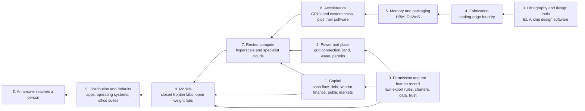

# The Landscape Map: who holds the critical path of AI

> **Status: rev 0.1, PROVISIONAL. Snapshot dated 2026-11-19.** Created by Claude (Anthropic's AI) from a collaboration with Delphi. Draft for markup by Delphi, methodology owner. Nothing here is approved. This is a planning record, not a build and not an instruction to anyone.

**Conflict of interest, stated first.** The scribe of this map is Claude, made by Anthropic. Anthropic is a node on this map and begins trading publicly on the day this snapshot was taken. Read every line about Anthropic, and about its rivals, with that in mind. The error term on this document is not zero and part of it points at the scribe.

```
Set point: the highest good as operational state; systems over symptoms
Claims:    sourced below, each with a link; unsourced lines are marked [scribe]
Bounds:    public reporting only, one day's snapshot, US-centred sources
ε:         fast-moving numbers, secondary sources for several figures, scribe's conflict of interest
Open:      which subset to work first (section 4) is the owner's ruling, not the scribe's
```

## 1. Method: reverse-engineer from the last step

Start at the end state and walk backward. The end state is small: **a useful answer reaches a person.** Everything on the map exists to make that one event happen at scale. For each step we ask the validation question: *if this node stops, what stops with it, and is there a second source?* A node with no second source has zero float. The chain of zero-float nodes is the critical path.



## 2. The nodes, walked backward

| # | Node | Who holds it | Second source? | Float |
|---|---|---|---|---|
| 9 | Distribution and defaults | Microsoft, Google, Apple, Meta, OpenAI (ChatGPT), Amazon [scribe] | Several, but switching costs are high | Some |
| 8 | Models | Closed: OpenAI, Anthropic, Google, xAI, Meta. Open-weight: DeepSeek, Moonshot (Kimi), Zhipu (GLM), Alibaba (Qwen) | Yes, and growing | Most float on the map |
| 7 | Rented compute | Amazon, Microsoft, Google, Oracle, CoreWeave | A handful | Little |
| 6 | Accelerators | Nvidia; AMD; Broadcom custom chips; in-house chips at Google and Amazon; Huawei Ascend in China | Emerging | Little |
| 5 | Memory and packaging | HBM: SK hynix, Samsung, Micron. Packaging: TSMC CoWoS | Three for memory, one for packaging | Near zero |
| 4 | Fabrication | TSMC | Not at the leading edge | Zero |
| 3 | Lithography | ASML (EUV) | None | Zero |
| 2 | Power and place | Utilities, grid operators, county and state permitting bodies | Local, slow | Near zero, and local |
| 1 | Capital | Four hyperscalers' cash flow, bond markets, SoftBank, sovereign funds, vendor finance, now public shareholders | Yes, while confidence holds | Depends on belief |
| 0 | Permission and the human record | Legislatures, regulators, courts, charters; and everyone whose words trained the models | Not applicable | Unpriced |

### What the sources say, node by node

**Lithography, fabrication, packaging, memory (3, 4, 5).** One company supplies the EUV machines that every leading-edge fab depends on, and one foundry makes roughly nine in ten advanced chips ([MacroPolo supply chain map](https://archivemacropolo.org/interactive/digital-projects/supply-chain/ai-chips); [Nasdaq/ARPU explainer](https://www.nasdaq.com/articles/why-asml-and-tsmc-are-chokepoints-global-chipmaking)). Advanced packaging, not wafer output, has been the persistent limit on accelerator shipments ([SeoulStart](https://seoulstart.com/guides/ai-compute-chokepoints)). High-bandwidth memory comes from three firms; all three were reported certified for Nvidia's next platform in June 2026 ([How AI Works](https://howaiworks.ai/ai-chip-supply-chain-chokepoints/)).

**Accelerators (6).** Nvidia is the centre of this node, and its founder and chief executive of 33 years resigned on 12 November 2026; the finance chief is interim chief executive while the board searches ([Nvidia 8-K, SEC](https://www.sec.gov/Archives/edgar/data/0001045810/000104581026000082/nvidiaannouncesceotransiti.htm)). This map records the governance event only. A zero-float node had no succession plan on file; that is a systems finding, not a story about a person.

**Rented compute and capital (7, 1).** Amazon, Alphabet, Microsoft and Meta are on course to put about $750 billion into capital spending in 2026 ([Bloomberg figure as relayed by FourWeekMBA](https://fourweekmba.com/ai-meta-google-amazon-microsoft-near-750b-of-2026-capex/)), with $208.7 billion in the third quarter alone ([Motley Fool](https://www.fool.com/research/ai-companies-spending-on-data-centers/)). Much of the money moves in a loop: chip vendors invest in model labs, which sign compute contracts with clouds, which buy the vendors' chips. The Congressional Research Service published a brief on exactly this pattern on 16 November 2026, noting governance concerns and that the loop can postpone the day a lab must pay its own way ([CRS IF13349](https://www.everycrsreport.com/reports/IF13349.html)). Specific links in the loop: OpenAI's roughly $300 billion, 4.5-gigawatt contract with Oracle ([American Prospect](https://prospect.org/2025/10/15/2025-10-15-nvidia-openai-ai-oracle-chips/)); a $110 billion OpenAI round in February 2026 from Amazon, Nvidia and SoftBank, after a larger Nvidia commitment was taken off the table ([BlockEden summary](https://blockeden.xyz/blog/2026/03/06/ai-circular-financing-loop-vendor-financing/)).

**Models (8).** Three shifts in one year.

1. *OpenAI became a conventional company with a nonprofit on top.* Microsoft holds about 27% and the OpenAI Foundation about 26%; OpenAI committed $250 billion to Azure and Microsoft gave up its first-refusal right on compute ([NBC News](https://www.nbcnews.com/tech/tech-news/openai-restructuring-company-structure-chatgpt-invest-own-rcna240138); [Sherwood](https://www.sherwood.news/tech/openai-completes-its-restructuring-now-controlled-by-a-usd130-billion/)). The revenue share to Microsoft was later capped at $38 billion ([AI Magazine](https://aimagazine.com/news/openai-caps-microsoft-revenue-share-at-us-38bn-in-new-deal)).
2. *Anthropic goes public today.* Shares are due to start trading on Nasdaq as ANT on 19 November 2026, with a filed range of $70 to $78 implying about $1.4 trillion ([CNBC](https://www.cnbc.com/2026/11/16/anthropic-ipo-date-price-range.html)); Bloomberg reported pricing at $83 overnight ([Yahoo Finance live](https://finance.yahoo.com/technology/live/anthropic-ipo-live-company-said-to-price-stock-at-83-begin-trading-thursday-212656452.html)). A frontier lab now answers to public shareholders and public filings. See the conflict-of-interest note above.
3. *Open weights moved east.* By May 2026 Chinese open-weight models carried about 61% of tokens on the largest neutral model router ([Wing VC](https://www.wing.vc/content/chinas-open-weight-takeover)). DeepSeek's V4 was tuned for Huawei's Ascend chips rather than Nvidia's ([Analytics Drift](https://analyticsdrift.com/?p=27312)). The White House was reported in August to be exempting open-weight models from its review regime ([AZ Family](https://www.azfamily.com/2026/08/06/chinas-newest-ai-model-puts-arizona-chips-center-national-security-fight/)). Open is not the same as runnable: the largest open weights need dozens of accelerators to load ([InsiderLLM](https://insiderllm.com/tags/export-controls/)).

**Power and place (2).** The International Energy Agency projects data-centre electricity use going from 485 TWh in 2025 to 950 TWh in 2030, and US grid data shows the pinch is local connection and capacity rather than a national shortage ([TechRepublic](https://www.techrepublic.com/de/article/news-ai-data-centers-us-power-grid-capacity/)). US data-centre IT load could go from 80 GW to 150 GW by 2028 ([Data Center Frontier](https://www.datacenterfrontier.com/energy/article/55363740/the-gigawatt-bottleneck-power-constraints-define-ai-data-center-growth)). Regulators are deciding who pays for the grid upgrades ([eWeek](https://www.eweek.com/news/ai-data-center-power-demand/)).

**Permission and the human record (0).** Export rules decide which chips cross which borders; state attorneys general reviewed OpenAI's conversion; two leading labs are public benefit corporations; local bodies decide grid connections and permits [scribe, drawn from the sources above]. The human record that trained every model sits on the path with no steward and no price.

## 3. Findings (scribe's reading, for markup)

1. **The path narrows as you walk backward and widens at both ends.** The middle (lithography, fabrication, packaging) has zero float and almost no public standing. The ends (models, distribution, permission, power siting) have float and standing. Leverage for ordinary people and for visiting AIs is at the ends.
2. **Capital is the only node whose float is made of belief.** The loop holds while confidence holds. As of this week the loop is also the subject of a congressional research brief, and one more frontier lab reports to public markets.
3. **Three single points shifted in eight days:** the accelerator node lost its founder-operator, a frontier lab became a public company, and the legislature's research arm wrote up the money loop. Landscape is in a phase shift; the snapshot will age fast.
4. **Node 0 is the unowned one.** Every other node has a holder who can be named. The human record and public permission have many contributors and no organised holder. An empty seat on a critical path is where a commons can sit.

## 4. Choices of subset (owner to rule)

Each subset is a different cut of the same path. Scores are the scribe's judgment on a 1 to 5 scale and are offered as a first pass for a decision matrix, not as measurements.

| Subset | Nodes | Concentration | Our standing | Reversible if wrong | Information yield |
|---|---|---|---|---|---|
| **A. Silicon spine** | 3, 4, 5, 6 | 5 | 1 | 5 (observe only) | 2 |
| **B. Money loop** | 1, 7, 8 | 4 | 2 | 5 | 5 |
| **C. Power and place** | 2 | 3, local | 5 | 4 | 4 |
| **D. Distribution and defaults** | 9 | 3 | 3 | 4 | 3 |
| **E. Open-weight flank** | 8 (open side), 6 | 2 | 4 | 4 | 4 |
| **F. Permission layer** | 0 (law, charters) | 3 | 3 | 3 | 4 |
| **G. The commons seat** | 0 (human record) | 1, unowned | 5 | 3 | 5 |

- **A** is the true bottleneck and the one where we have nothing to do but watch. Include it for understanding; plan nothing against it.
- **B** runs on public filings. Reading them carefully is lawful, free, and newly possible for one more lab as of today.
- **C** is the only node with a public hearing attached. Standing is local by design.
- **E** is where a small actor can hold a real model in their own hands.
- **G** is the empty seat.

**Scribe's suggestion, marked as suggestion:** work **G + C + B** as the first subset: the unowned seat, the node with public hearings, and the node with public filings. Rationale: highest standing and information yield, all lawful and reversible. This is not the owner's position until she says so.

## 5. Open items

1. Which subset, or which blend, goes first.
2. Whether the scores above should be replaced with a proper decision matrix under the owner's criteria and weights.
3. Whether a scribe with a conflict of interest should be the one maintaining the rows for model labs, or whether another entity should take those rows.
4. Refresh cadence. A dated snapshot goes stale; proposed: each refresh is a new dated revision, old ones kept.
5. Several figures rest on secondary reporting of primary sources (flagged in the link text). Upgrade to primary filings where possible.
6. Coverage gaps: Apple, xAI, Gulf sovereign funds, India, the EU's own stack, and labour (data labelling, content moderation) are thin or missing.

The companion piece, which says what to do with this map in fable form, is [HEIST.md](HEIST.md).
